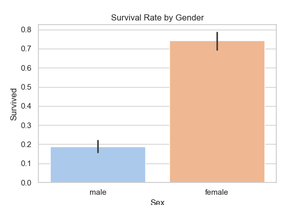

# Hi, I'm WU NIRONG.

## About Me
I am a data science student passionate about extracting insights from data. I enjoy using Python and various data analysis tools to solve real-world problems.

## Technical Skills
*   **Programming Languages:** Python
*   **Data Analysis & Visualization:** Pandas, NumPy, Matplotlib, Seaborn
*   **Tools:** Jupyter Notebook, Git, GitHub

## Project Showcase

### Titanic Data Analysis

**Research Question:** 
What factors (such as gender and passenger class) were most strongly associated with passenger survival on the Titanic?

**Approach:** 
I used Python and pandas to clean the dataset (handling missing values in Age and Embarked, dropping the Cabin column), and used Matplotlib/Seaborn to visualize survival rates across different demographics.

**Visualization:**

*(Figure 1: Bar chart showing the survival rate of male vs. female passengers on the Titanic.)*

**Findings:**
Gender was a crucial factor: females had an approximately 74% survival rate compared to males at 19%. Additionally, passenger class mattered significantly, with 1st class passengers having a much higher survival rate (~63%) than 3rd class passengers (~24%).

**Limitation:**
The analysis is limited to the provided historical sample. Dropping the `Cabin` column due to excessive missing data may have excluded relevant location information that could influence survival.

**Project Repository:**
[View the code and README](https://github.com/CC66-cloud/data-science-project)

**Status:** Completed
